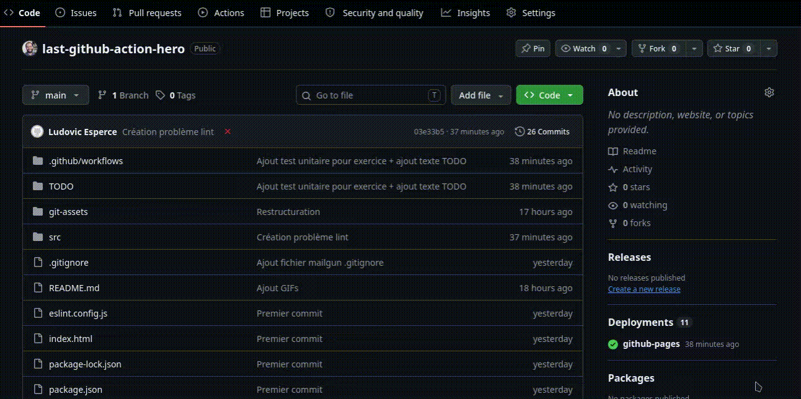
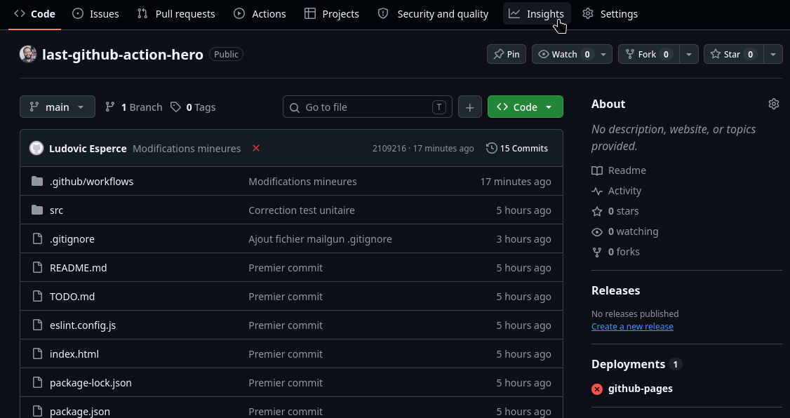
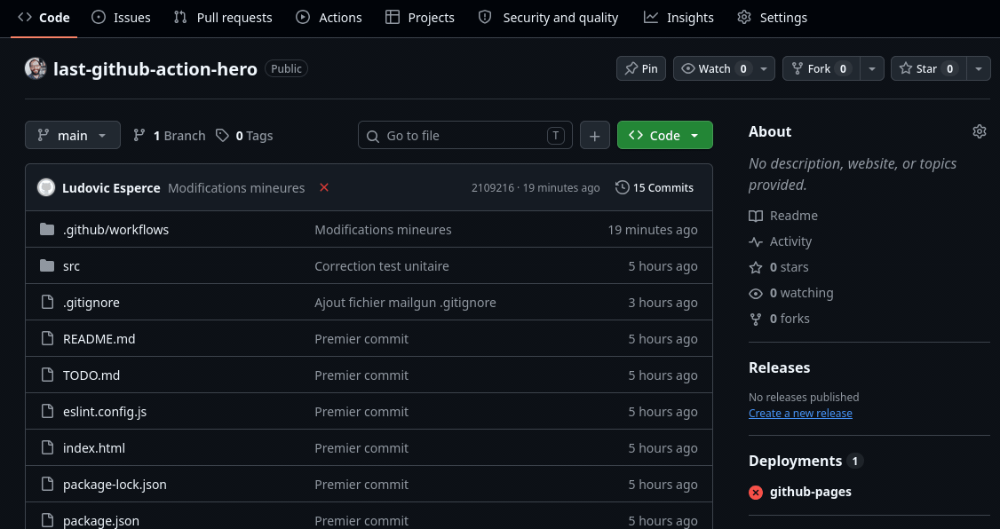
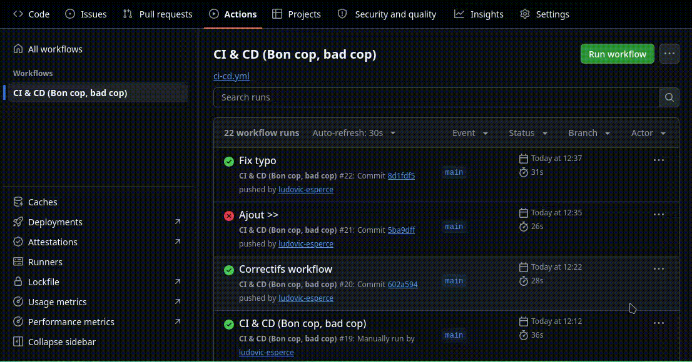

# Mise en pratique

## Marche à suivre

Chaque exercice peut se faire de deux façons :
- en modifiant le repo puis en faisant un `git push`
- en éditant directement les fichiers sur `Github`


## Partie 1 : intégration continue

### Briefing -> mise en place du workflow

Le code de mise en place du workflow est fourni, voici un descriptif de sa structuration :
```yml
# Nom du workflow
name: CI & CD (Bon cop, bad cop)

# Trigger : l'événement qui déclenche le pipeline
on:
  push: # Type de l'action
    branches: [main] # Branche concernée
  pull_request:
  workflow_dispatch: # permet le lancement du workflow manuel

permissions: # règle les permissions du WORKFLOW en lecture seule
  contents: read # un jeton temporaire GITHUB_TOKEN est créé et utilisé avec ces droits

# Début de la liste des jobs
jobs:
  # To be continued...
```

### Choix de l'équipement -> mise en place de l'environnement de build

Lors de la déclaration d'un "job" et avant la déclaration il faut préciser son `runner`.

Le `runner` est un conteneur fourni par Github, voici le code pour utiliser un conteneur `Ubuntu` en version `26.04` : 
```yml
jobs:
  # Un JOB se déroule sur une machine spécifique
  # Les étapes partagent le même disque
  ci: # Nom du job
    runs-on: ubuntu-26.04 # Machine "ubuntu" fournie par Github
    steps:
      - # ...to be continued...
```


### Die Hard, bienvenue à la fête camarade -> déclenche le linter

La veille de Noël, tout semble calme... Tout ? C'est sans compter les variables infiltrées (et non utilisées) dans le code.

Le workflow fait appel à un `linter` ou **analyseur statique de code** (capable de détecter les variables inutilisées, certaines erreurs de syntaxe, le non respect de certaines bonnes pratiques ou conventions de nommage).

Sur le projet fourni l'analyseur peut être appelé avec la commande :
```sh
npm run lint
```

Dans le workflow Github, ajoutez à l'endroit indiqué l'étape suivante (bien faire attention à l'indentation) :
```yml
  - id: lint
    name: Die Hard - Vérification statique - Lint
    run: npm run lint
```

La commande `run` d'une étape permet de déclencher un commande dans le `shell` du `runner` (la machine virtuelle Ubuntu).

Une fois l'étape ajoutée, étudiez le résumé du workflow pour corriger le code.

Vous pourrez accéder au résumé d'un workflow comme suit :



> [!IMPORTANT]
> Si une étape du workflow échoue un **flag d'échec** passe à `true`.
>
> Par la suite vous verrez qu'il est possible de mettre une condition `if:` sur les étapes.
>
> Si aucun `if:` est explicitement indiqué le workflow se comporte comme si il y avait `if: success()`
>
> Explicitement, cette étape de `lint` serait :
> ```yml
>  - id: lint
>    if: success() 
>    name: Die Hard - Vérification statique - Lint
>    run: npm run lint
> ```

### Terminator, "Sarah Connor?" -> casse un test

Un test unitaire a été cassé et la plus brilliante des intelligences artificielles, "Govenator", est là pour empêcher le workflow de progresser.

Les tests unitaires peuvent être lancés en local en utilisant la commande :
```sh
npm test
```

Dans le workflow Github, ajoutez à l'endroit indiqué l'étape suivante :
```yml
  - id: test
    name: Terminator - Tests unitaires
    if: ${{ !cancelled() }}
    run: npm test
```

Avec l'aide du résumé d'erreur, corrigez le code du fichier `src/lib.test.js`.

### Résumé 1ère mission -> Github Markdown

Il est possible d'ajouter des rapports qui seront intégrés aux résumé Github.


Ceci peut-être fait en écrivant du **Markdown** dans la variable `$GITHUB_STEP_SUMMARY` dans un `run` du runner.

Dans le workflow Github, ajoutez à l'endroit indiqué l'étape suivante :

```yml
- name: Rapport CI
  if: always()
  env: # Déclaration de plusieurs variables réutilisables dans le rapport
    LINT: ${{ steps.lint.outcome }}
    TEST: ${{ steps.test.outcome }}
    BUILD: ${{ steps.build.outcome }}
    ARTIFACT_UPLOAD: ${{ steps.artifact.outcome }}
  run: |
    {
      echo "## Rapport : CI"
      echo ""
      echo "| Étape | Résultat |"
      echo "|---|---|"
      echo "| Vérification statique | $LINT |"
      echo "| Tests unitaires | $TEST |"
      echo "| Build | $BUILD |"
      echo "| Upload artifact | $ARTIFACT_UPLOAD |"
      echo ""
      echo "_Réalisé par ${{ github.actor }} · commit \`${GITHUB_SHA::7}\`_"
    } >> "$GITHUB_STEP_SUMMARY"
```

> [!TIP]
> Le pipe `|` permet de regrouper plusieurs lignes de `run` dans un même script.
>
> Les accolades `{}` indique que tout ce qui est affiché sur la sortie standard avec "écho" doit être redirigé dans la variable **$GITHUB_STEP_SUMMARY**.

---

## Partie 2 : déploiement continu

### Rambo, derrière les lignes ennemies -> déploiement Github Page

Pour que le déploiement puisse se faire il faut veiller à activer les `Github Pages` pour le dépôt :



Une fois l'activation effectuée il est possible d'utiliser l'action [`deploy-pages`](https://github.com/marketplace/actions/deploy-github-pages-site) en effectuant un téléchargement de `l'artefact` dispnible et créé par la première partie du workflow.

L'artifact est déposé par la première partie du workflow avec l'action [`upload-pages-artifact`](https://github.com/actions/upload-pages-artifact) :
```yml
  - id: artifact
    name: Création d'artefact
    uses: actions/upload-pages-artifact@v4
    with:
      path: dist
```

Si cette étape est bien ajoutée à la partie CI, vous pouvez ajouter l'étape de déploiement :
```yml
  - id: deployment # Déploiement automatique de l'artefact github-pages
    name: Rambo - déploiement derrière les lignes ennemies
    uses: actions/deploy-pages@v4
```

Un fois le déploiement effectué, vous savez ce qu'il vous reste à faire :


### Résumé 2ème mission -> Github Markdown

Comme pour le résumé **Markdown** de la partie CI, ajoutez un résumé tel que :
```yml
  - name: Résumé Github pour CD
    if: always()
    env:
      DEPLOY: ${{ steps.deployment.outcome }}
      URL: ${{ steps.deployment.outputs.page_url }}
    run: |
      {
        echo "## Rapport CD"
        echo ""
        if [ "$DEPLOY" = "success" ]; then
          echo "Mission accomplie ! l'application est déployée : $URL"
        else
          echo "Mayday! Mayday! Impossible de déployer l'application."
        fi
      } >> "$GITHUB_STEP_SUMMARY"
```

### This is the end -> envoi d'email en fin de workflow

L'envoi d'email peut s'effectuer en utilisant un serveeur `SMTP`, dans cet exemple est utilisé [`mailgun`](https://app.mailgun.com). Les informations de connexion vous seront fournies afin que votre pipeline puisse s'y connecter.

Plusieurs actions permettent d'envoyer des email, c'est le cas de [`send amil`](https://github.com/marketplace/actions/send-email).

```yml
  - name: Rapport par email
    if: always() && env.MAIL_PASSWORD != ''
    uses: dawidd6/action-send-mail@v6
    with:
      server_address: smtp.mailgun.org
      server_port: 587
      username: ${{ secrets.MAIL_USERNAME }}
      password: ${{ secrets.MAIL_PASSWORD }}
      to: ${{ secrets.MAIL_TO }}
      from: "Last GitHub Action Hero <${{ secrets.MAIL_USERNAME }}>"
      subject: "CD ${{ job.status }} : ${{ github.repository }}"
      body: |
        Rapport N°${{ github.run_id }}

        Le déploiement de ${{ github.repository }} est terminé.

        Résultat : ${{ job.status }}
        Site     : ${{ steps.deployment.outputs.page_url }}
        Branche  : ${{ github.ref_name }}
        Commit   : ${{ github.sha }}
        Auteur   : ${{ github.actor }}

        Détails : ${{ github.server_url }}/${{ github.repository }}/actions/runs/${{ github.run_id }}
```

Afin que l'action Github puisse se connecter au serveur il faudra ajouter des `secrets` utilisable dans le workflow :



Il faudra ajouter 3 secrets utilisés par le workflow :
- `MAIL_USERNAME` : nom de l'utilisateur utilisé pour l'envoi d'email
- `MAIL_PASSWORD` : mot de passe utilisé pour l'envoi
- `MAIL_TO` : adresse email du destinataire


### Décoration pour service rendu : badge Github

Github génère automatiquement un [badge d'état de flux de travail](https://docs.github.com/fr/actions/how-tos/monitor-workflows/add-a-status-badge) utilisable.

Il est possible d'ajouter le code de ce badge d'état à votre `README.md` de dépôt.

Le code permettant de le faire vous est fourni sur la page d'un workflow spécifique :


